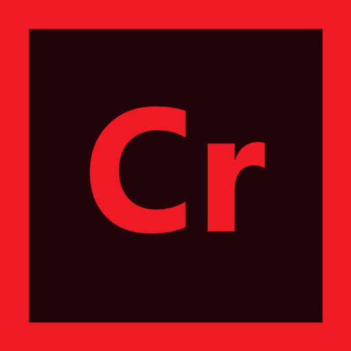
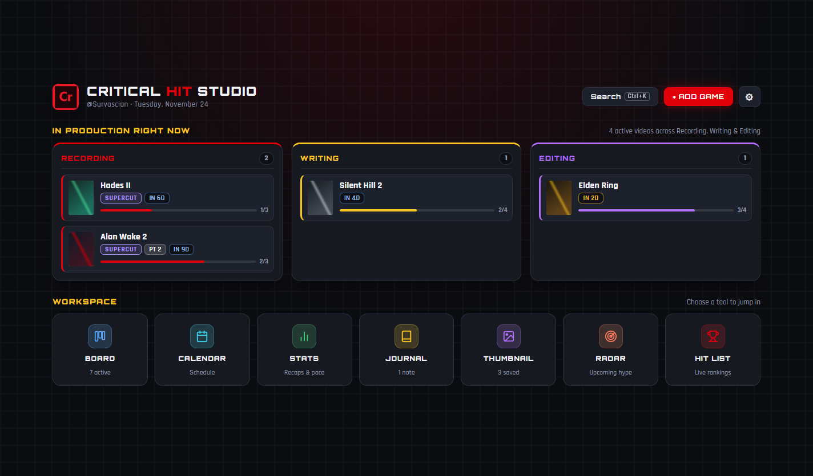
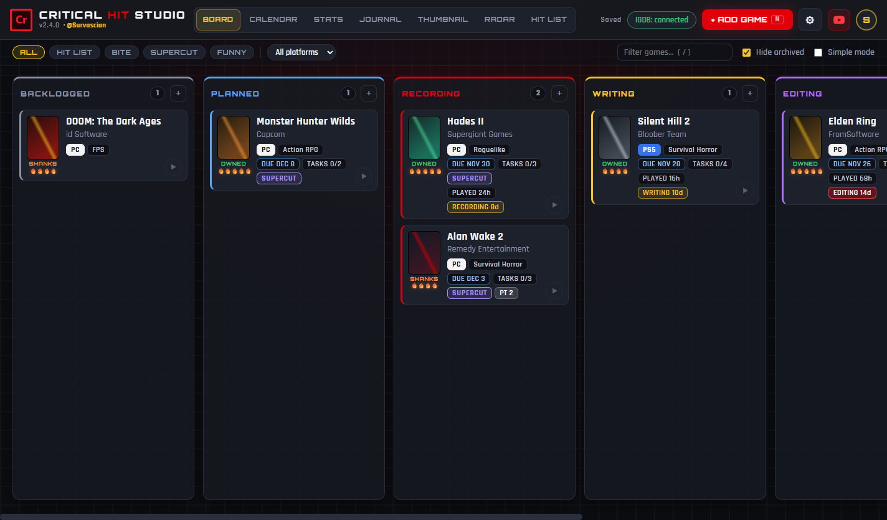
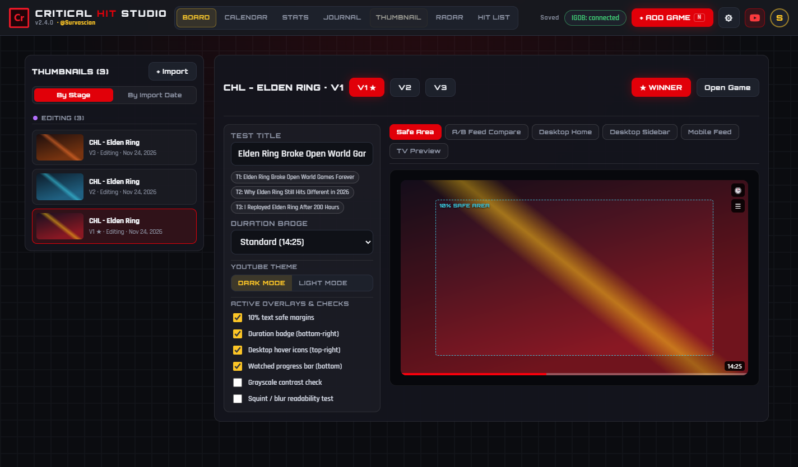
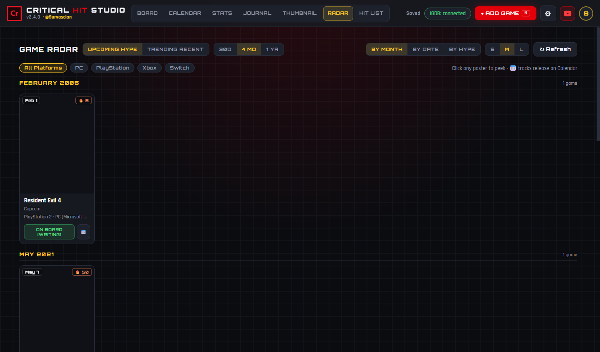
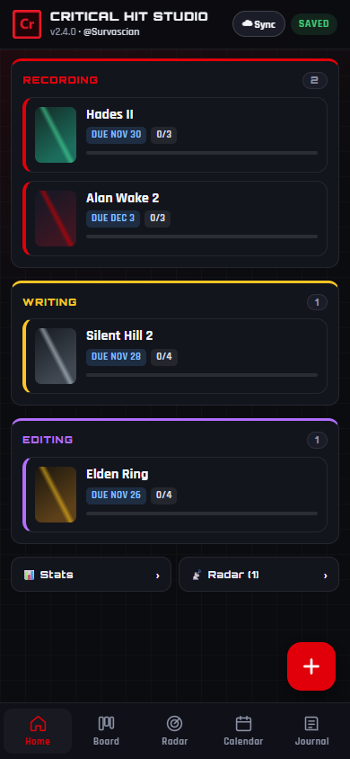
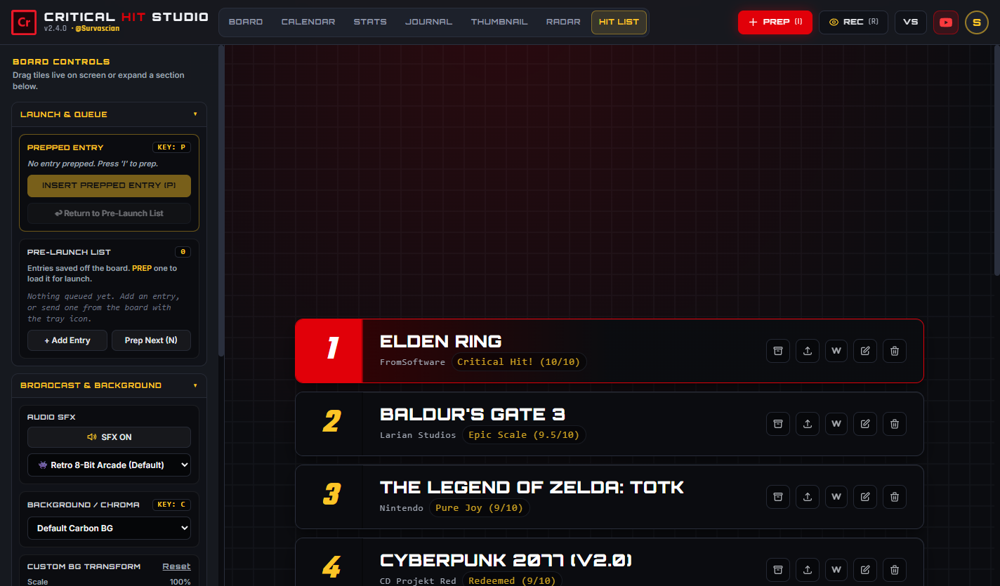

<p align="center">
  
</p>

<h1 align="center">Critical Hit Studio</h1>

<p align="center">
  <strong>A production hub built for gaming YouTubers and solo video creators</strong> — combining a distraction-free <strong>Content Planner</strong>, <strong>YouTube Thumbnail Checker</strong>, <strong>Game Radar</strong>, <strong>Mobile Companion app</strong> with real-time cloud sync, and an <strong>OBS Ranking Overlay</strong> in one lightweight desktop app.
</p>

<p align="center">
  <a href="https://github.com/survascian/critical-hit-studio/releases/latest"><strong>Download Latest Release (Windows &amp; Android)</strong></a>
</p>

> **Disclaimer:** This Application was Vibecoded through Gemini, then Claude, then Gemini Antigravity. The only thing that I created was a few logos, everything else was AI-generated. I want to be very clear I have zero coding experience.

> Built by a solo gaming creator to stay organized without drowning in busywork, bloated templates, or subscriptions.

<p align="center">
  
</p>

---

## Download (No Coding Required)

Grab the latest installers directly from the **[Releases](https://github.com/survascian/critical-hit-studio/releases/latest)** page:

| Platform | File | Notes |
| --- | --- | --- |
| **Windows (Installer)** | `Critical-Hit-Studio-*-win-setup.exe` | Adds Desktop & Start Menu shortcuts. *(Windows SmartScreen may show a warning because the app isn't code-signed — click **More info → Run anyway**.)* |
| **Windows (Portable)** | `Critical-Hit-Studio-*-portable.exe` | Run from anywhere, no install needed. |
| **Android (Mobile Companion)** | `Critical-Hit-Studio-*-android.apk` | Sideload onto Android (allow *"Install unknown apps"* once). |

---

## What It Does

### 1. Full-Screen Home & Content Planner (Windows Desktop)



* **Full-Screen Home Launchpad:** Opens directly onto your active videos in `Recording`, `Writing`, and `Editing` with live checklist progress bars and target-date countdowns, plus a clean icon dock below to jump into any tool (configurable in **Settings → Appearance → Open on launch**).
* **9-Stage Production Board:** Track games from `Backlogged` → `Planned` → `Recording` → `Writing` → `Editing` → `Reviewing` → `Published` (plus `Shelved` & `Cancelled`) with drag-and-drop, fire hype indicators (`🔥`), and stage checklists.
* **Multi-Format Cards & Parts:** Tag a game being recorded with multiple formats (e.g., `HIT LIST` + `SUPERCUT`), then **Split** into separate cards or **`+ Add Part`** (`PT 1`, `PT 2`…) with instant switcher links inside the Game Editor.
* **Focused Game Editor (`Simple` / `Advanced`) & `Ctrl+K` Quick Jump:**
  * **Quick-Launch Essentials:** Launch the game (`.lnk`, `.exe`, `steam://`), open your script (Google Docs *or* local `.docx`/`.md`/`.pdf`), and open your footage/project folder.
  * **Zero-Bloat Ideation:** Optional collapsible **Scratchpad**, **Packaging** (3 title candidates with winner picker + up to 3 attached thumbnail versions), and one-click **`JOURNAL IT`**.
  * **Game Details & Artwork:** Pull studio, release date, smart-ordered genres, platforms, and time-to-beat from **IGDB**, and pick custom posters, banners, and transparent logos from **SteamGridDB**.
* **Calendar, Journal & Stats:** Drag-and-drop target dates, tracked game release reminders, `.ics` Google Calendar export, standalone dated **Journal**, and **Monthly & Year-End Recaps**.
* **Customizable Themes & Built-In Updater:** Switch live between **Vanilla**, **ISAC // SHD**, **Discord**, and **OLED Black**, with one-click GitHub Releases updates and portable Studio Backups.

### 2. Standalone YouTube Thumbnail Checker



* **Full Thumbnail Library:** Browse every thumbnail attached across your board sorted **By Stage** or **By Import Date**, or `+ Import` standalone concepts.
* **6 Live Preview Modes:** Test **Safe Area (10% margins)**, **A/B Feed Compare** (V1 / V2 / V3 side-by-side in a mock YouTube grid), **Desktop Home**, **Desktop Sidebar (168px)**, **Mobile Feed**, and **TV Preview**.
* **Real-World Checks:** Toggle **YouTube Dark / Light Mode**, **Duration Badges**, **Desktop Hover Icons**, **Watched Progress Bar**, **Grayscale Contrast**, and **Squint Blur** readability tests.

### 3. Game Radar (Powered by IGDB)



* **Upcoming Hype & Trending Recent:** Discover the most anticipated releases over the next **30 Days**, **4 Months**, or **1 Year**, grouped **By Month**, **By Date**, or **By Hype** with **S / M / L** poster sizing and platform filters (`PC`, `PlayStation`, `Xbox`, `Switch`).
* **Quick Peek & Calendar Reminders:** Click any poster to inspect its IGDB summary and release countdown, add directly to **Backlogged** or **Planned**, or tap **`📅`** to pin the game's release date onto your **Calendar**.

### 4. Android Mobile Companion (`.apk`)

<p align="center">
  
</p>

* **Built for phones, not a squished desktop page:** Bottom 5-tab bar (`Home`, `Board`, `Radar`, `Calendar`, `Journal`), floating `+` button, and a focused mobile Game Sheet.
* **Press-and-Hold 8-Icon Stage Mover:** Press and hold any game card (or tap `⇄`) to float it above a 3×3 grid of the other 8 stages around a center `✕` Cancel button — slide your thumb onto a stage and release to move (with haptic feedback and Undo).
* **Real-Time Cloud Sync (Optional):** Create a free account inside **Settings → Data & Backup → Cloud Sync** on PC and sign in on Android to sync your board, journal, Calendar release reminders, and posters live in both directions.

### 5. Critical Hit List (OBS Ranking Overlay)



* **Built-in OBS Overlay:** Control your ranked game list live or recorded straight from the app, mirrored to OBS in real time via a clean collapsible **Board Controls** sidebar.
* **Subjective Awards & Polish:** Uniform 92px rows, custom logo/banner fitting, 3 award styles (*Laurel wreath*, *Medal*, *Neon hex*) with held pop-in animation (`A`), and arrow-key panning.
* **Head-to-Head (`VS`) Compare Overlay:** Spoiler-free banner + logo showdown with staged intros (`V`) and 3 live-switchable victor animations (`1` / `2`): *Knockout Smash*, *Golden Coronation*, and *Critical Hit Slash*.

---

## Optional Setup Guides

Everything works out of the box with manual entry. When you want extras:

### OBS Browser Source
While Critical Hit Studio is running on PC, add a **Browser Source** in OBS:
* **URL:** `http://localhost:8787/hitlist?display=1`
* Leave **Local file** unticked. Control it from the app's **Critical Hit List** tab.

### IGDB Game Metadata (Free)
1. Go to [dev.twitch.tv/console](https://dev.twitch.tv/console) (Twitch requires 2FA) and click **Register Your Application**.
2. Set OAuth Redirect URL to `http://localhost`, Category to *Application Integration*, Client Type to *Confidential*.
3. Copy your **Client ID** and generate a **New Secret**, then paste both into **Settings → IGDB & Art** and click **Test connection**.

### SteamGridDB Artwork & YouTube Stats (Free)
* **SteamGridDB:** Paste a free API key from `steamgriddb.com/profile/preferences/api` in **Settings → IGDB & Art** to browse custom posters, banners, and transparent logos.
* **YouTube:** Link your `@handle` in **Settings → YouTube** for a top-bar channel avatar and one-click YouTube Studio link. Add an optional free YouTube Data API v3 key to pull public upload lists and video/channel stats.

---

## Privacy & Where Your Data Lives

* **Local-first on PC:** All planner data, daily backups (last 30 kept), cached art, and API keys live in `%APPDATA%\Critical Hit Studio\`.
* **API keys never leave your PC:** Your Twitch/IGDB, SteamGridDB, and YouTube keys are stored only in local `settings.json` and are never uploaded to Cloud Sync.
* **Cloud Sync is opt-in:** Each user's synced planner is isolated to their own account via Firestore security rules.

---

## Running from Source (Developers)

```bash
npm install      # first time only
npm start        # run Electron desktop app
npm test         # run all 10 automated test suites (uses local fake APIs, no keys needed)
npm run dist     # build Windows NSIS installer & portable .exe into dist/
```

No Electron? Run `start-browser-mode.bat` (or `node server/server.js`) to open the app in your browser at `http://localhost:8787/`.

---

## Changelog

### v2.4.0 — A/B Thumbnail Compare, Radar Calendar Reminders, `Ctrl+K`, OLED Black & Mobile Parity
* **Thumbnail Checker:** Added **A/B Feed Compare** (V1/V2/V3 side-by-side in a mock YouTube Home grid), **YouTube Dark / Light Mode**, and **Grayscale + Squint Blur** readability checks.
* **Game Radar:** Added platform filters (`PC`, `PlayStation`, `Xbox`, `Switch`), time window toggle (`30D` / `4 MO` / `1 YR`), **Quick Peek** summary modal, and one-click **`📅` Add to Calendar** release reminders.
* **Home & Daily Flow:** Added live checklist progress bars and countdown badges on Home cards, a **Global Command Palette (`Ctrl+K`)**, and **Related Parts / Formats** quick-switcher chips inside the Game Editor.
* **Themes, Backup & Mobile:** Added the **OLED Black** theme, one-click **Full Studio Backup Export / Restore**, and brought **Home** and **Radar** to the Android companion app.

### v2.3.0 – v2.3.1 — Home Landing Page, Game Radar & Collapsible Hit List Controls
* Added the full-screen **Home** landing page (instant zero-flash launch, configurable in **Settings → Appearance → Open on launch**).
* Added the **RADAR** page powered by IGDB with **By Month**, **By Date**, and **By Hype** sorting and **S / M / L** poster sizing.
* De-cluttered the **Hit List** header bar and reorganized **Board Controls** into 6 clean collapsible sections.
* Improved the Game Editor **Scratchpad** to a calm, readable note-taking font.

### v2.2.3 — Visual Polish & Redesigned Cr App Icon
* Redesigned the **Cr** app icon in a crisp Adobe Creative Suite style across Windows, top bar, and Android.
* Fixed Discord theme pill vertical centering and upgraded Discord scrollbars to a readable light grey.
* Theme-styled studio names on board cards: `@blooberteam` in **Discord** and `BLOOBER_TEAM` in **ISAC // SHD**.

### v2.2.2 — Standalone THUMBNAIL Checker Page
* Moved the YouTube Thumbnail Checker out of the Game Editor into its own top-level **THUMBNAIL** tab in the header.
* Added a full Thumbnail Library sorted **By Stage** (e.g. `Editing` → `HIT LIST - DISPATCH`) or **By Import Date**, plus standalone image importing and one-click jumping from any game's Packaging section.

### v2.2.1 — YouTube Thumbnail Safe-Area & Multi-Device Checker
* Upgraded the in-editor Thumbnail Preview into a full **YouTube Thumbnail Checker** with 5 views (*Safe Area*, *Desktop Home*, *Desktop Sidebar 168px*, *Mobile Feed*, *TV Preview*).
* Added live overlay toggles: **10% Text Safe Margins**, **Duration Badge** (*Standard / Long-form / LIVE / Custom*), **Desktop Hover Actions**, and **Watched Progress Bar**, plus one-click title candidate switching (`T1 / T2 / T3`).

### v2.2.0 — Thumbnail Previews, Multi-Format / Parts & One-Click Updater
* **3 Thumbnail Versions + YouTube Preview:** Attach up to 3 thumbnail images right inside **Packaging**, pick a winner, and preview them large or at realistic YouTube feed card size with your chosen title.
* **Multi-Format Cards, Split & `+ Add Part`:** Toggle multiple video formats on a single card while recording (e.g. `HIT LIST` + `SUPERCUT`), then click **Split** if you end up making both—or click **`+ Add Part`** for multi-part Supercuts (`PT 1`, `PT 2`…) without double-counting Hours Played.
* **Built-In GitHub Updater:** Automatically checks GitHub Releases on launch with a top-bar update badge, one-click **Download & Install** on Windows, and an **Update APK** alert on Android.
* **Fire Hype Indicator:** Moved Public Hype under the Ownership label on the left of each board card as fire symbols (`🔥`).

### v2.1.0 — Mobile Companion App, Cloud Sync & In-App Changelog
* **Mobile Companion UI (`/mobile`) & Android `.apk`:** Purpose-built touch UI packaged via Capacitor + automated GitHub Releases.
* **8-Icon + Center `✕` Floating Stage Mover:** Press and hold any game card (or tap `⇄`) to slide-drop into any of the other 8 stages with haptics and Undo.
* **Real-Time Cloud Sync (Optional):** Free Email/Password sync between PC and Android, with per-item timestamp merging and automatic poster sync.
* **In-App Changelog:** Added a **Changelog** tab inside Settings.
* **Security Hardening:** Strict `http:`/`https:` validation for external links and exact origin/port checks on local API writes.

### v2.0.0 – v2.0.2 — Themes & Quick-Filter Polish
* Added **Vanilla**, **ISAC // SHD**, and **Discord** themes in **Settings → Appearance** (server-side applied with zero flash; Hit List board/OBS overlay stays untouched).
* Moved Filter, Hide Archived, and Simple Mode controls to the right side of the quick-filter bar and improved pill contrast across themes.

### v1.9.0 – v1.9.3 — Personalization, Recap, Simple Mode & VS Overlay
* Introduced the spoiler-free **Head-to-Head (`VS`)** overlay with staged reveals (`V`) and 3 victor animations (*Knockout Smash*, *Golden Coronation*, *Critical Hit Slash*).
* Added **Simple Board Mode**, collapsible Game Editor sections, 2-pane sidebar Settings, customizable Vanilla accent colour, optional Hit List & Numeric Scores toggles, editable Video Formats & Ownership labels, 2-step Quick Setup wizard, Quick-Filter bar, Series grouping, Project/Footage folder picker, Import Recent YouTube Uploads, and **Monthly & Year-End Recaps**.

### v1.8.0 – v1.8.5 — Streamlined Editor, Journal & YouTube Linking
* Streamlined the Game Editor to a balanced 50/50 Advanced layout, optional collapsible Scratchpad (+ *Your take* / *Cold open*), and one-click `JOURNAL IT`.
* Added YouTube channel linking (`@handle`), cached top-bar avatar, deep-linked YouTube Studio buttons, public uploads dropdown, local PC script file picker, standalone **Journal** tab, `.ics` Google Calendar export, and automatic logo trimming.

<details>
<summary>Earlier Releases (v1.3.0 – v1.7.0)</summary>

* **v1.7.0:** Days-in-stage alerts for Writing/Editing, Packaging (3 title candidates + thumbnail idea), Timely flag, upload schedule slots, and *Where the time goes* Stats.
* **v1.6.5:** Red `Cr` app icon, live version display, uniform 92px Hit List rows, and zero-flicker font loading.
* **v1.6.0:** Per-entry Hit List award layouts (Laurel, Medal, Neon Hex), held pop-in animation (`A`), arrow-key panning, and Ownership labels.
* **v1.5.0:** Subjective Hit List Special Awards and planned awards in the Planner.
* **v1.4.0 – v1.4.5:** Game launcher shortcuts, Calendar drag-and-drop, customizable board card chips, SteamGridDB art picker, and unified top bar.
* **v1.3.0:** IGDB theme-aware genre ordering, stage checklists, YouTube video stats, Stats view, and 10-second Delete Undo.

</details>
